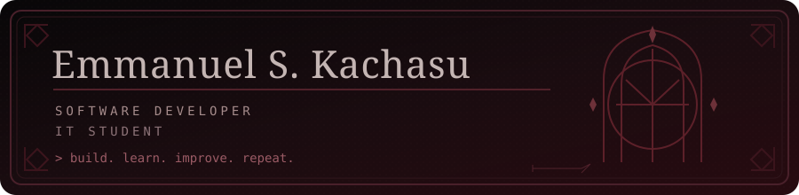

## > 𝔄𝔟𝔬𝔲𝔱 𝔐𝔢

ℑ'𝔪 𝔈𝔪𝔪𝔞𝔫𝔲𝔢𝔩 𝔖. 𝔎𝔞𝔠𝔥𝔞𝔰𝔲, 𝔞 𝔅.𝔖𝔠. ℑ𝔫𝔣𝔬𝔯𝔪𝔞𝔱𝔦𝔬𝔫 𝔗𝔢𝔠𝔥𝔫𝔬𝔩𝔬𝔤𝔶 𝔰𝔱𝔲𝔡𝔢𝔫𝔱 𝔞𝔫𝔡 𝔰𝔬𝔣𝔱𝔴𝔞𝔯𝔢 𝔡𝔢𝔳𝔢𝔩𝔬𝔭𝔢𝔯 𝔴𝔥𝔬 𝔢𝔫𝔧𝔬𝔶𝔰 𝔟𝔲𝔦𝔩𝔡𝔦𝔫𝔤 𝔲𝔰𝔢𝔣𝔲𝔩 𝔰𝔬𝔣𝔱𝔴𝔞𝔯𝔢, 𝔢𝔵𝔭𝔩𝔬𝔯𝔦𝔫𝔤 𝔫𝔢𝔴 𝔱𝔢𝔠𝔥𝔫𝔬𝔩𝔬𝔤𝔦𝔢𝔰, 𝔞𝔫𝔡 𝔦𝔪𝔭𝔯𝔬𝔳𝔦𝔫𝔤 𝔱𝔥𝔯𝔬𝔲𝔤𝔥 𝔥𝔞𝔫𝔡𝔰-𝔬𝔫 𝔭𝔯𝔬𝔧𝔢𝔠𝔱𝔰.

💻 𝔖𝔬𝔣𝔱𝔴𝔞𝔯𝔢 𝔇𝔢𝔳𝔢𝔩𝔬𝔭𝔪𝔢𝔫𝔱 · 🌐 𝔚𝔢𝔟 𝔇𝔢𝔳𝔢𝔩𝔬𝔭𝔪𝔢𝔫𝔱 · 🧩 𝔓𝔯𝔬𝔟𝔩𝔢𝔪 𝔖𝔬𝔩𝔳𝔦𝔫𝔤 · 📚 𝔏𝔦𝔣𝔢𝔩𝔬𝔫𝔤 𝔏𝔢𝔞𝔯𝔫𝔦𝔫𝔤

## > 𝔗𝔢𝔠𝔥 𝔖𝔱𝔞𝔠𝔨

## > 𝔊𝔦𝔱ℌ𝔲𝔟 𝔖𝔱𝔞𝔱𝔰

<table width="100%">
<tr>
<td align="center" width="52%"></td>
<td align="center" width="48%"></td>
</tr>
</table>

**𝔓𝔄𝔖𝔖ℑ𝔒𝔑. 𝔓ℜ𝔈ℭℑ𝔖ℑ𝔒𝔑. 𝔓𝔈ℜ𝔉𝔒ℜ𝔐𝔄𝔑ℭ𝔈.**

*𝔊𝔯𝔢𝔞𝔱 𝔰𝔬𝔣𝔱𝔴𝔞𝔯𝔢 𝔦𝔰 𝔟𝔲𝔦𝔩𝔱 𝔬𝔫𝔢 𝔩𝔦𝔫𝔢 𝔞𝔱 𝔞 𝔱𝔦𝔪𝔢.*

