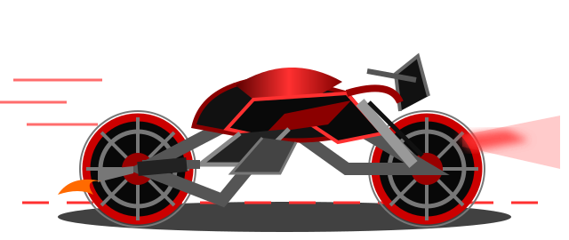

## > About Me

I'm **𝕰𝖒𝖒𝖆𝖓𝖚𝖊𝖑 𝕾. 𝕶𝖆𝖈𝖍𝖆𝖘𝖚**, a B.Sc. Information Technology student and software developer who enjoys building useful software, exploring new technologies, and sharpening my skills one project at a time.

💻 Software Development · 🌐 Web Development · 🧩 Problem Solving · 📚 Lifelong Learning

## > Tech Stack

**Languages** 

  
**Frontend** 

  
**Backend & Databases** 

  
**Tools & Platforms** 

  

## > GitHub Stats

**PASSION. PRECISION. PERFORMANCE.**

*“Great software is built one line at a time.”*

